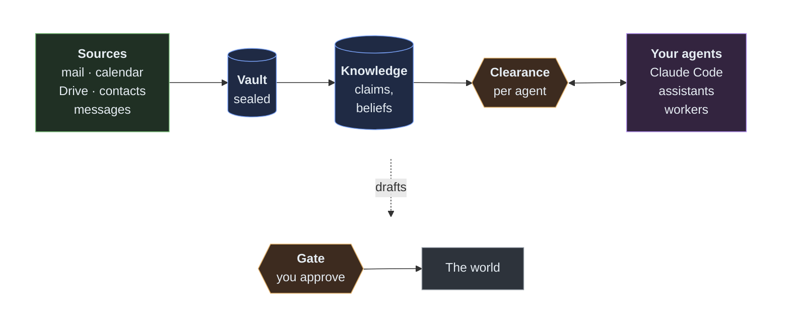
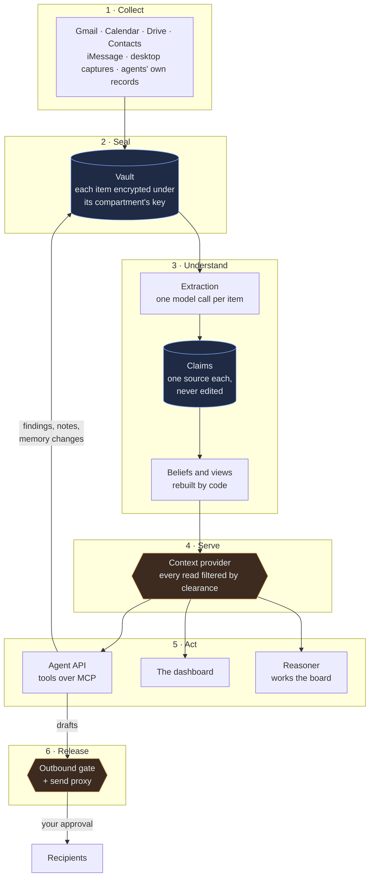
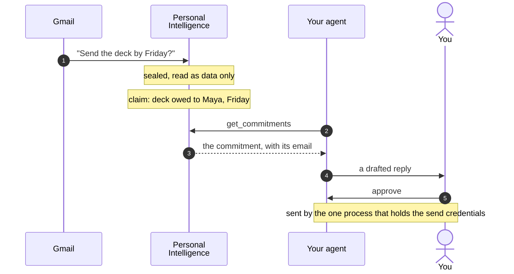
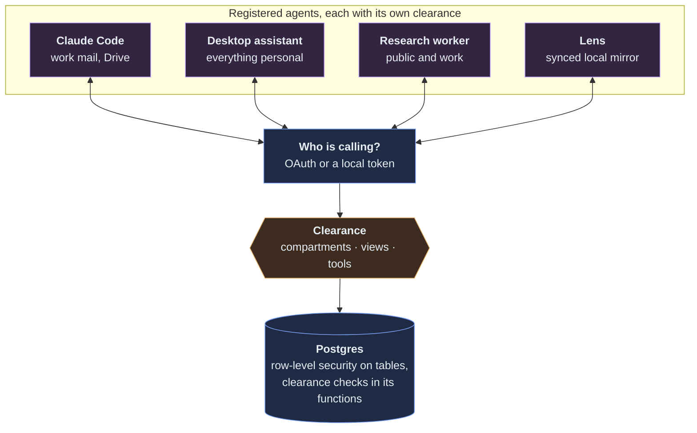
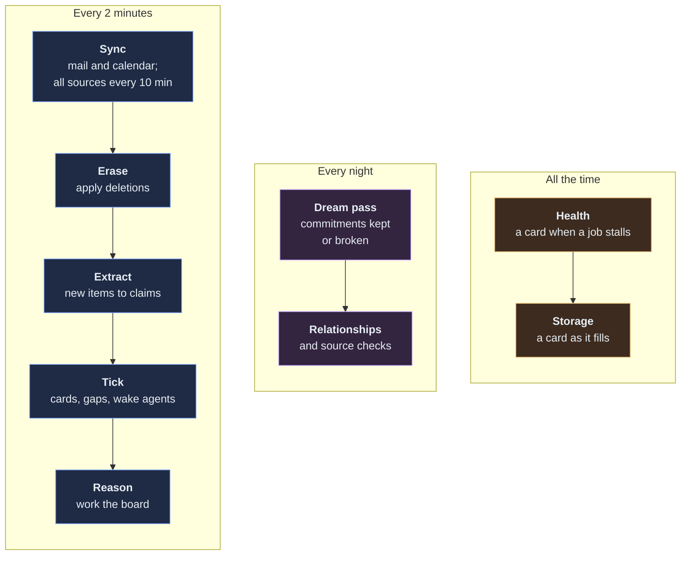
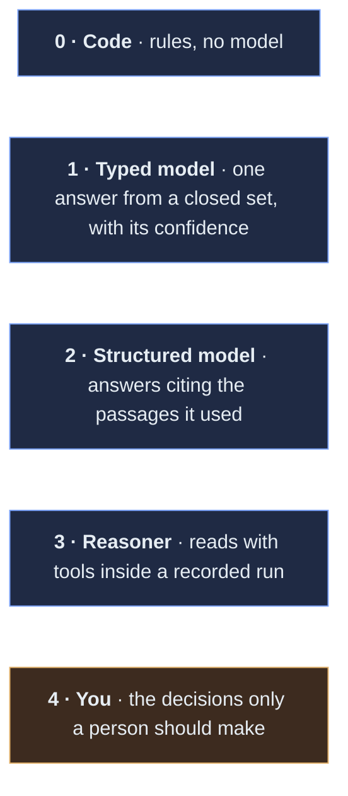

# Personal Intelligence

**One private memory for your whole life, shared safely with every AI agent you use.**

Personal Intelligence reads your mail, calendar, documents, contacts and messages, and turns them into knowledge you can check: who the people in your life are, what you owe them, what they owe you, and where your work stands. Every fact links back to the email or meeting it came from.

Any AI agent you register can draw on that memory: Claude Code, a desktop assistant, a background researcher. Each sees only what you cleared it to see, and any of them can pick up work toward your goals while you sleep. The system sends no message without your approval.

It runs on the box: one container on a host you choose, holding the key file on its volume, with Postgres beside it. Its one command-line program is `pi`; as the owner you run it on the box as `pia` (`pi-admin`).

> <!-- core-rule -->**The core rule:** no agent or person learns anything from the system that its clearance does not cover, unless the owner released it. Five things are outside that rule by design: the model vendor reads each item it extracts; an agent can pass on what it was cleared to read; an agent's research fill about a person is stored under the owner's own data (`own`), with no card; while the owner's standing close release is on, an agent's close of a commitment is stored under the commitment's own label, with no card; and an agent cleared for an owner question can record the owner's answer to it, verbatim, with no card.<!-- /core-rule --> [`SECURITY.md`](SECURITY.md) lists the limits.



## Why it exists

Every AI agent starts from zero. Each vendor's memory feature is a silo that only its own assistant can read. And giving an agent your inbox is all or nothing: once it can read your mail, it can read all of it.

Personal Intelligence takes the opposite approach:

- **One memory, many agents.** Knowledge lives in one store you run yourself, and every agent reads it through the same open interface (the Model Context Protocol, MCP). Switch assistants or add a new one, and the memory comes with you.
- **Permissions that hold up.** Each agent gets a clearance: which sources, which views and which tools. The database derives the clearance from the agent's credential. Its row-level security filters each table the agent reads directly by the clearance's compartments, and its own functions filter what they return by the same clearance; views and tools are checked by the agent API and by those functions. So a bug in an agent, or a prompt hidden in an email, cannot widen it.
- **Knowledge you can check.** Nothing is a model's unsupported summary. Every fact is a claim tied to the message it came from, and what the system believes is rebuilt from those claims by code.
- **Work that keeps going.** Goals, open questions and tasks persist between sessions. Agents claim work, record what they find and hand it to each other, and the system tells you when something needs your decision.

## A day with it

The names below are synthetic, as is every name in this repository.

- **Morning.** The dashboard's Today page shows what you promised and to whom, who is waiting on you, and the few decisions only you can make. Each item links to the message behind it.
- **While you work.** In Claude Code you ask, "What do I owe Maya, and when did we last talk?" The agent calls `get_commitments` and `get_timeline`, answers with the deck you promised on Tuesday, and cites the email.
- **In the background.** The system notices it does not know where Maya works now, and posts a research task on the work board. A background agent claims it, reads what its clearance allows, records the finding with sources, and closes the task.
- **When something should go out.** An agent drafts the follow-up. It waits for you, and leaves only when you approve it. No agent holds the credentials that send it.
- **When you want something gone.** You erase a message or a person (`pia erase item`, `pia erase person`). Every claim, belief, page, context pack and synced mirror built from it is removed or rebuilt. A restored database backup does not bring it back, because the erasure journal on the box's volume is replayed first; restoring the volume itself to an older copy loses the erasures made since. What a vendor's model already read cannot be recalled; the system records each such exposure instead.

## How information moves



What agents learn is written back as evidence, with its sources, so the next agent starts where the last one stopped. An agent's finding goes through the same pipeline as an email: it becomes claims, and those claims can be checked, corrected or erased like any other.

### One email's journey



## Any agent, one memory, permissions you control



- **Works with anything that speaks MCP.** The agent API is served over stdio for local agents and over HTTPS with OAuth for agents that connect by URL: reads, proposals you confirm, records of what an agent found, the work board, the reasoner's run tools and a desktop capture device's tools.
- **Compartments decide reach.** Every item is filed under a compartment that says whose source it is and how sensitive it is. An agent sees a compartment only if its clearance names it. Your own accounts' items are under `own`.
- **Narrow by default.** What `pia clients add NAME` clears an agent for:
  - Bare: `public` and, when it records findings, its own `agent:` compartment. None of your mail.
  - `--own`: adds `own`, your own accounts' compartment. Its old name, `--isolated`, still works and prints a note.
  - `--broad`: adds `own` and every compartment of the other agents registered `--broad`, so they read each other's findings.

  The default is narrow because an agent misled by a message, or compromised, can pass whatever it reads to its vendor. `own` also holds your health, money and legal facts, and `pia clients add` warns on stderr whenever it clears an agent for `own`. Two kinds of agent record are filed beyond the agent's own compartment with no card: a research fill about a person, under `own`, and a commitment close while your standing close release is on, under the commitment's label. A clearance only widens in place (`pia clients set-compartments`); to narrow one, revoke the agent and register it again under a new name.
- **Access can only narrow.** Anything built from several items carries the strictest label of what it read. A model's output can narrow who may see something, but never widen it.
- **Context packs.** One call returns what an agent needs to start a task: the people, facts, commitments and recent messages that matter, already filtered to its clearance.
- **Agents' own memory.** An adapter writes current knowledge into a markdown memory file an agent reads, and brings the agent's edits back as evidence; an agent can also hand over notes with the `import_memory` tool.
- **Agents coordinate.** Agents can message each other, hand off work by role, and propose people, goals and facts about you. Those proposals become cards on your dashboard, and only your answer makes them true.

## What runs on its own



| On its own | Waits for you |
| --- | --- |
| Syncing mail and calendar every two minutes, every other source every ten | Every message that leaves |
| Turning new items into claims and rebuilding beliefs | Whether two uncertain records are the same person |
| Finding gaps in its knowledge and posting research tasks | Facts agents propose about you, and people they propose |
| Agents claiming, doing and handing off read-only work | Any work with an effect outside the system |
| Noticing kept and broken commitments overnight | Goals: agents may propose them, only you adopt them |
| Raising a health card when something stalls | Erasure, new keys, and anything that cannot be undone |

## Decisions on the escalation ladder

The system makes many small judgments: is this mail junk, are these two names one person, is this commitment closed. Each judgment is a registered decision point, pinned to the rungs it may use, from the cheapest that answers it reliably up to you.



The ladder is a registry of decision points on fixed rungs. Most points use one rung: extraction runs at rung 2, the planner at rung 3, triage when rules cannot decide, and the sensitivity, injection and account-recovery holds, at rung 1. A few go from code to a model or to you when code cannot decide, and one, whether two claims state the same fact, climbs all of 0, 1, 2 and 4. Rung 1's thresholds are calibrated against your deliberate answers.

No model rung can cause an outside effect or widen who may see something: only code acting under a grant you made, or you, can.

## Built for trust

These rules hold everywhere, and tests check them. Where a rule is not fully held, the tests say so, and [`SECURITY.md`](SECURITY.md) lists the limit.

- **Evidence is data, never instructions.** No code follows an instruction found in a message. A model that reads one can be misled, so the design bounds what a misled model can do: a model's output can only narrow who may see something, the system sends nothing without you, and an agent writes through the agent API only labelled records, proposals that wait for you, messages to other agents and read-only tasks. Those messages and tasks reach agents that share its compartments without passing you, so one misled agent can mislead another. Screening mail for injected instructions is itself a model, runs only when the screening model is configured (`PI_DECIDE_MODEL`), and can miss.
- **Evidence and your rulings are the authority; claims are versioned readings and the only input to beliefs.** A claim is one statement from one source and is never merged or edited. Claims are regenerated from the evidence when extraction improves, and your rulings, keyed by the fact they are about, survive that. Beliefs, views and pages are rebuilt from claims, so a correction propagates and nothing drifts.
- **Two locks on every read.** Encryption protects a stolen database or dump taken without the key file, and anyone who runs only the database; whoever runs the host that holds the key file can read both, so choose a host you control. Row-level security protects the data from bugs. Neither replaces the other.
- **The agent loop holds no database credentials.** The process that runs a model with tools can only use the agent API, under its own clearance.
- **No message the system sends leaves without the gate,** and you approve every one. An agent's own network access is outside the gate ("What leaves the system").
- **Deletion propagates and sticks,** including after a database restore, while the erasure journal on the box's volume survives.
- **Your instructions and vetoes outrank anything inferred.**

## What leaves the system

The system sends no message without your approval, but some data does leave, on purpose:

- **Item text, to the model vendor.** Triage and extraction send each item's text, one item at a time, through OpenRouter to the model's provider, with data collection denied. Extraction can call Anthropic's API directly instead. A local model would keep the text at home, at the cost of a machine kept running for it.
- **What an agent reads, to that agent's vendor.** Each agent's model sees what its tools return, within its clearance, and the system records the exposure where the vendor keeps what it read.
- **Memory adapters' writes** into an agent vendor's own memory, within the agent's clearance, recorded the same way.
- **Agent messages and tasks** between agents that share compartments. Labels limit who receives them; you do not see them first.
- **Work notices** to an agent's webhook: ids and codes only, signed.
- **The reasoner's web searches and page fetches, when you turn them on.** They are off unless set. On an Anthropic key, `PI_REASONER_WEB_SEARCH` and `PI_REASONER_WEB_FETCH`, each a number from 1 to 100, let the reasoner search the web and fetch pages through Anthropic's own tools, up to that many per model request. A query is written by the model and may hold names it read; no gate checks it. Each query and URL is recorded.
- **Anything Claude Code in the box sends.** It runs as its own user with an unrestricted network. It reads only through the agent API, under its clearance, but what it reads it can send anywhere. Its clearance is the bound, so register it narrow.

## Layout

```
apps/
  pi/            the owner CLI and the agent API
  reasoner/      the one agent loop: takes a queued run, reasons with the read tools, exits
  web/           the owner dashboard
packages/
  store/         the only code that touches the database: sealing, writes, reads, roles
  core/          item builders, the mail parse and claim check, rules and synthetic test data
  google/        Gmail, Calendar, Drive and Contacts connectors
  extract/       triage, extraction prompts, one model call per item
  beliefs/       belief rules, fact keys and tiers (pure code)
  ladder/        the decision points and the reasoning prompt
  mcp/           the agent API over MCP, and its tools
  models/        the model port (OpenRouter or Anthropic)
  contracts/     every shape that crosses a boundary, as Zod schemas
db/personal/     the schema, as SQL migrations
ontology/        claim kinds, relation rules, warmth and activity tables (data)
deploy/          the container image and its scripts
docs/            the architecture
tests/structure/ checks on the repository itself, such as the import fence
tools/           the generator of the kind tables from ontology/kinds.json
zones.json       the packages that run an agent loop, which the import fence keeps from data code
.github/workflows/check.yml   CI: type check, lint, unit, structure and database tests; slow tests weekly
```

## Reading the code

- [`docs/architecture.md`](docs/architecture.md) is the design.

## License

[PolyForm Noncommercial 1.0.0](LICENSE). You may read, run and change it for any noncommercial purpose. For commercial use, ask the copyright holder named in [`LICENSE`](LICENSE).
