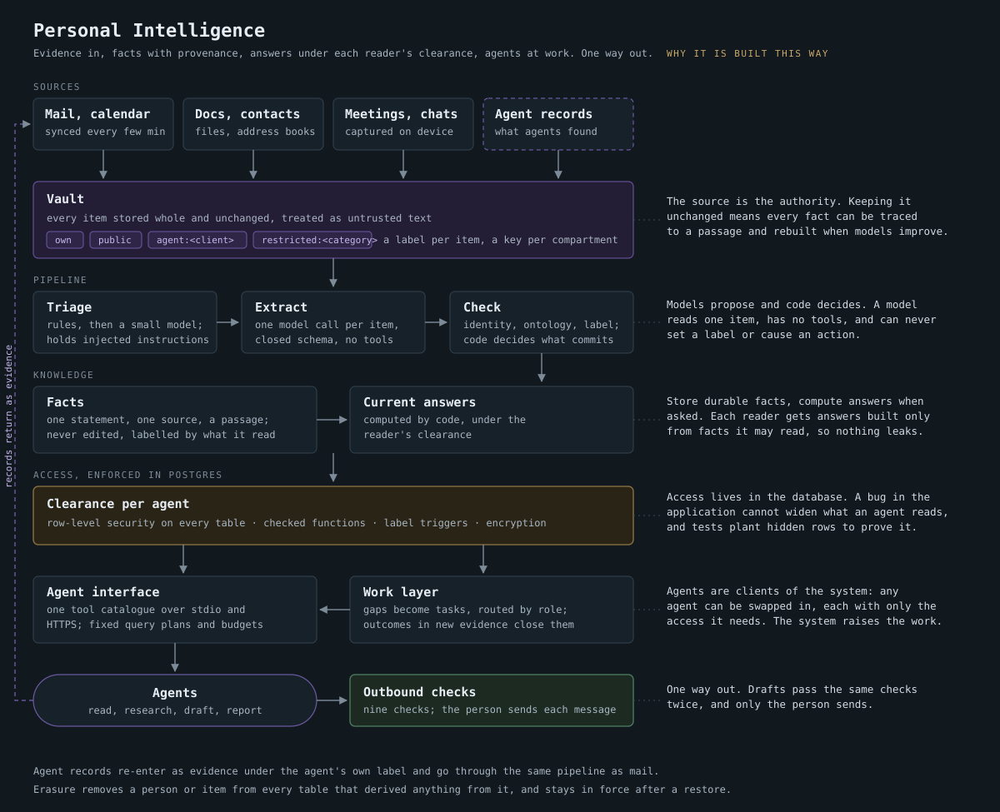
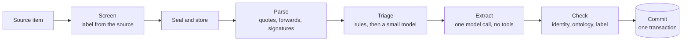
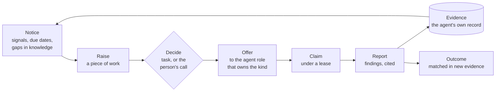
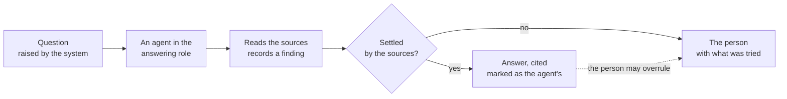
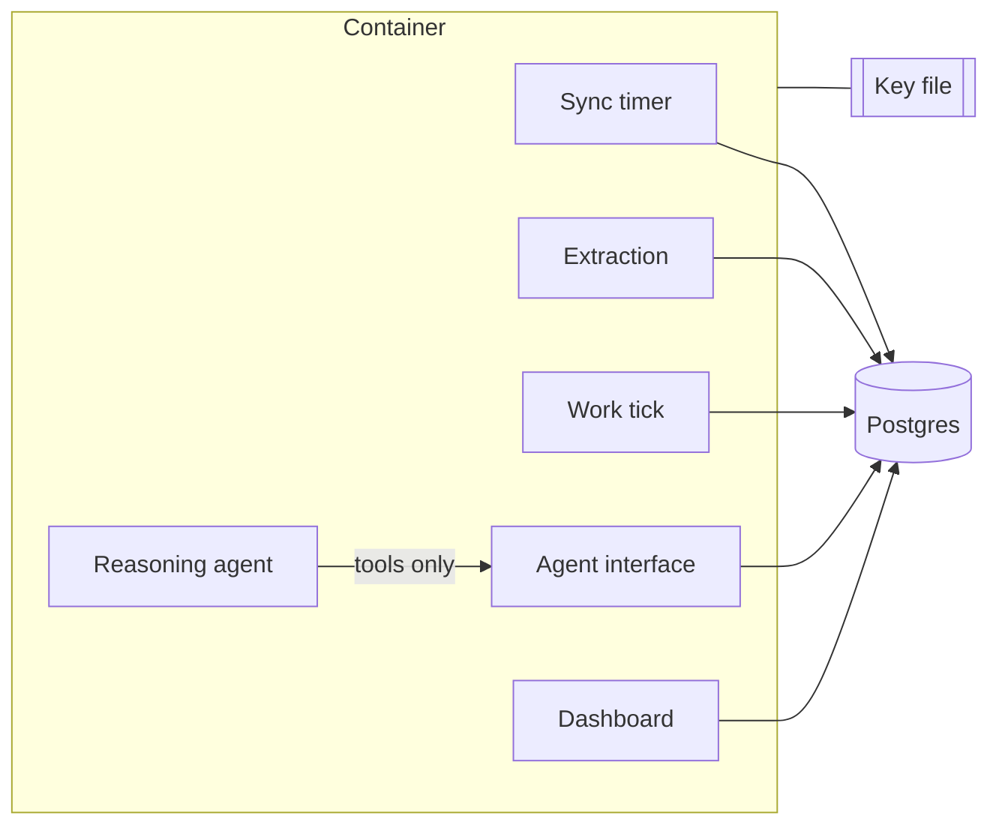

# Architecture

Personal Intelligence is the memory and awareness layer for a person's working life. It reads what they see in mail, calendars, contacts, documents, chats and meetings, turns it into facts that each trace to a source, and lets any agent they choose work from those facts. Every agent sees only what its clearance covers, and the database enforces it. The system watches for what is due, changed or missing, and gives that work to agents before anyone asks.

## What it makes possible

| Moment | What the system does |
| --- | --- |
| A promise in a message | The promise becomes a tracked commitment with a due date. When it comes due, a follow-up task goes to an agent, and when a later message keeps the promise, the commitment closes by itself. |
| A meeting tomorrow | A preparation task goes to an agent the day before: who is attending, what was last said, what is still open between them. |
| A name with no known person | A research task goes to an agent, and what it finds comes back as researched facts, labelled and cited. |
| A question about the person | The person's agents try to answer it from the sources first. The person is asked only what no agent could settle. |
| A changed answer | A contract's date moves from the first quarter to the second in a later message. Every answer that used the date moves to the newer message and cites it. |

## The system at a glance

Data moves one way: from sources, to facts, to answers. Agents write back as a source of their own, so what an agent records enters the vault as evidence and goes through the same pipeline as mail. Every message the system sends leaves through one gate, and the person sends each one.

## An example, end to end

A contact writes: "I'll send the revised proposal by Friday."

1. **Arrives.** Sync stores the message under the label of the account it came to, encrypted.
2. **Becomes a fact.** Extraction reads it and proposes a commitment, owed to the person, due Friday. Code credits it to the contact, checks it against the ontology, labels it with the message's label, and commits it.
3. **Becomes an answer.** Any agent cleared for that label that asks what is owed sees the commitment, citing the message.
4. **Comes due.** In the two days before Friday, the commitment is coming due, and a follow-up task is raised and offered to the agent role that handles follow-ups.
5. **Is worked.** An agent claims it and reads the thread. If the proposal has not arrived, it drafts a short reminder, which passes the outbound gate and waits for the person, who sends it.
6. **Closes.** On Monday the proposal arrives. The pipeline reads it, the commitment is matched as kept, and the work closes with the new message as its outcome.

## Why this design

A memory layer for a person's whole working life must be useful to any agent and safe to hand to any agent. Three decisions make both true at once.

### Facts with provenance

- **The problem.** A colleague writes in March that a contract will close in the first quarter, and in April that it has moved to the second. Search over raw mail can return the March message, and nothing marks it as stale.
- **The design.** Each statement becomes a fact tied to the passage it came from. Code picks the answer that holds now from all the facts about it, by fixed rules.
- **The result.** Every answer cites its source. A correction reaches everything that used the fact, an erasure can find every copy, and a better model can re-read the same evidence and produce better facts.

### Access enforced by the database

- **The problem.** An instruction planted in a shared document can steer an agent's next query. A model that screens queries can be talked past. An access check in application code, or a policy service in front of the database, is one more step that a new tool or a hand-written query can skip.
- **The design.** Each agent holds a clearance, and Postgres applies it to every row on every query path. The process that runs an agent loop holds no database credentials at all.
- **The result.** A misled agent sees exactly what its clearance covers and nothing more. The protection is policy, trigger and function SQL, and tests plant rows outside an agent's clearance against every tool and every function an agent can call.

### Agents as clients

- **The problem.** Agents improve every few months. A system that embeds one agent has to be rebuilt around the next, and an agent with broad access is a broad risk.
- **The design.** The system owns capture, interpretation, access and measurement. Agents own judgment and action, and connect through one interface.
- **The result.** Any agent can be swapped in, each gets exactly the access its work needs, and every read and write is recorded.

## Principles

Every part of the code follows these rules. Most are enforced by a test that tries to break them.

1. **Source text is data.** Mail, documents and web pages are stored unchanged and returned to agents as untrusted text. No process follows an instruction found in them.
2. **Evidence is the authority.** A fact is one statement from one source and is never edited. Answers, views, indexes and pages are derived from facts by code and can be rebuilt at any time.
3. **Access follows the source.** An item's readers are the people who could read it where it came from. Anything derived from items takes the union of their compartments and the intersection of their readers. A model or an agent can narrow a label; only the person can widen one.
4. **What an agent cannot see changes nothing it sees.** Answers, counts, ordering and refusals are computed only from rows the agent may read.
5. **Answers are derived.** The store keeps evidence, rulings, the work ledger and facts. Every answer is computed from facts by code at the moment it is asked for, under the reader's clearance, and no answer is stored.
6. **Models propose; code decides.** Every decision with a consequence has a fixed rung on a ladder: code with exact rules, a small model choosing from a closed set, a larger model that cites its passages, the reasoning agent, and the person. No model output can widen access or cause an external effect.
7. **The system observes; agents act.** The system measures itself and raises work, and agents make the changes. Left to itself, the system can only stop, hold or ask.
8. **The person keeps what is irreversible or outward.** Widening access, sending, spending and erasing each take the person's own act. Explicit instructions and vetoes outrank anything inferred.

## Labels and access

Access control is the layer everything else stands on, so it lives in the database, where application code cannot widen it.

An item's readers are the people who could read it at its source: a message's sender and recipients, an event's attendees, a channel's members, a document's sharing list. Content can narrow that set, as when an item is marked restricted, and can never add to it. Each installation serves one person, so each source account maps to a compartment of that person's data, and agents are cleared compartment by compartment. A label is a set of compartments and a set of readers.

- **Compartments.** A label is a set of compartments. `own` holds the person's own sources, `public` holds pages fetched as research, `agent:<client>` holds one agent's records, `declassified` holds facts the person released, `restricted:<category>` marks health, money, legal and intimate content once a category is turned on, and `employer:<org>` holds a work account.
- **Clearance.** Each agent is a registered client with a clearance: the compartments it may read. The agent interface forwards the agent's credential and never states a clearance. A database function looks the client up, and every read is filtered by what it returns.
- **Row-level security** is enabled and forced on every table. Agent entry points that read across tables run as checked functions that apply the caller's clearance in their own SQL, and tests plant hidden rows against each of them.
- **Label checks.** A trigger refuses a fact whose label differs from its source item's. Three narrow exceptions each have their own rule: an agent's record the person released, and, under the person's standing releases, an agent's close of a commitment and a research fill about a person.
- **Encryption.** Every content column is encrypted under a key for its compartment, held in a key file outside the database. Disk encryption covers a stolen disk. This covers anyone who can read the database without the key file: a leaked dump or backup, a stolen database credential, an operator of the database who cannot reach the container's volume. Whoever runs the host itself can reach both. Row-level security covers bugs and encryption covers operators; the design needs both. Search runs on clear columns and on keyed fingerprints of names, addresses and fact keys.
- **Process separation.** Each trust boundary runs as its own Unix user with only the credentials its job needs: the agent interface, the send process, the notice sender, the reasoning agent and the agent inside the container each have one. Sync, extraction, the work tick and the person's commands share one user, which holds the whole key file. The process that runs an agent loop reaches the store only through the agent interface.

**Code:** `packages/store/src/core` (keys, sealing, labels, roles), `db/personal/migrations` (policies, triggers and functions), and `db/personal/surface` (the declared security surface the hidden-row tests are generated from).

## From source to fact

Every item takes the same path. Models read; code decides what commits.

1. **Screen and store.** The source account sets the base label. The item is stored whole and encrypted. Attachments are recorded by name, type and size and never fetched.
2. **Parse.** Code splits quoted and forwarded text so each statement is credited to the person who wrote it, and keeps a signature or a contact card with its sender's text.
3. **Triage.** Rules, then a small classifying model, decide whether a person wrote the item, and hold anything that looks like an injected instruction or sensitive content.
4. **Extract.** One model call per item returns facts in a closed schema. The model has no tools and sees one item at a time.
5. **Check.** Code resolves who each fact is about, validates it against the ontology, gives it an id derived from its content, and labels it with everything the extraction read.
6. **Commit.** Facts, their references and the ledger entry commit together.

Extraction is versioned. When a prompt or model improves, the new generation is first tried on a sample, then re-reads each item and replaces that item's facts at commit, behind a gate that holds back a change the check does not accept.

**Code:** `packages/google` (connectors), `packages/core` (item builders and parsing), `packages/extract` (triage, extraction and checks), and `packages/models` (the model port).

## Knowledge

Facts are stored; answers are computed from them by code each time they are asked for.

- **Facts.** One statement from one source, with its speaker, time and passage, and a type from the ontology in `ontology/`. A fact is never merged or edited.
- **Answers.** A registered set of kinds has a current answer: commitments, decisions, project status, roles, affiliations, needs, capabilities, relationships, goals, preferences, constraints, situations, and the consent and contact rules the outbound gate reads (`ontology/belief-kinds.yaml`). A kind joins the set when work needs its current value; everything else is served as facts with their citations. Code picks the answer that holds by fixed rules: an explicit veto first, then the person's rulings, then the evidence, then recency. It computes the answer when it is asked for, under the reader's clearance, so no answer is shaped by facts the reader cannot see, and none is kept to go stale.
- **Subjects.** Each fact records what it is about: the person, someone else, an organization or a project. Self, People and Work are views over one store.
- **Identity.** Accounts are kept apart from people. Only an exact address links an account to a person automatically. A shared name makes a candidate pair, merged only under the person's rules, through a database function that checks the match again. Every merge can be undone.
- **Projects and commitments.** Facts are tied to projects by fixed anchors such as folders, calendar series and recurring threads. Promises in either direction are tracked as commitments with due dates.
- **Tiers.** Every fact served says whose word it rests on, in ten ranked tiers: the person's own word, what they confirmed, what an agent relayed from them, what their own capture shows they did, an automated notice about them in their mail, another source's statement, research, an agent's fact a second agent confirmed, an agent's close of a commitment, and an agent's unconfirmed inference. An agent's unconfirmed inference never builds an answer, and an agent's close counts only beside the commitment it closes.

**Code:** `packages/beliefs` (the rules for answers, fact keys and tiers), `packages/store/src/pipeline` (relations between facts), and `packages/store/src/identity`.

## The agent interface

Agents connect over stdio or HTTPS with OAuth to one endpoint that serves a fixed catalogue of tools. Each tool is a fixed query plan with a time budget and a declared order for every list it returns.

- **Read tools** find facts, people, messages, documents, timelines and paths between people, and assemble context packs for a purpose such as preparing for a meeting.
- **Write tools** record findings, propose a person, a goal or a task, and report the outcome of work. An agent's records enter the vault under the agent's own compartment and go through the pipeline like any other source.
- **Session marking.** A session that read raw message text is marked, refused restricted facts, and has its writes counted.
- **Memory.** Agents keep their own memory in their own runtime. A memory adapter, run where that runtime keeps its files, writes one markdown file for an agent: its current answers, computed under its clearance, each line stamped with the answer it came from. Edits to the memory files the person names are imported back as the agent's own records, matched to the stamped lines they change. An erasure removes each change an agent imported after it was served what was erased, and the next run writes the file without it. What a runtime keeps outside those files is beyond the system's reach.

**Code:** `packages/mcp` (the endpoint and tool catalogue), `packages/store/src/read` (the read tools' queries), and `packages/store/src/agent-writes`.

## Proactive work

The system makes work happen without being asked. It notices what is due, changed or missing, turns each into a piece of work, offers that work to agents outside itself, and takes what they find back in as knowledge.

1. **Notice.** Code computes signals when they are read, under the reader's clearance: overdue, due soon, a meeting moved, a reply waiting, a new person, a gap. No model raises anything.
2. **Raise.** Daily triggers prepare work before it is asked for: a meeting coming up becomes a preparation task, and a commitment coming due becomes a follow-up. Gaps in what the system knows become research tasks: a name that resolved to no person, a goal with no warm path to its target, a meeting with someone barely known. The number raised follows how much work finishes, so the board cannot outrun the agents working it.
3. **Decide.** A task is read-only work agents pass among themselves: research, a brief, gathered context. It never contacts anyone or changes an account. An opportunity has an effect outside the system or needs judgment, and the person decides it.
4. **Offer.** Each kind of work routes to an agent role. An agent is eligible when its clearance covers the work's label, it holds the role, and it has the tools. The work appears on its board, and an agent with a registered address also receives a signed notice of ids and codes. The notice grants nothing; the agent reads the work under its own credential. Dated work is offered at once, knowledge gaps are batched into one notice a day, and unclaimed work moves to the next agent after a wait.
5. **Claim and work.** An agent claims work under a lease it renews while working, and receives a brief: what to work from and what done requires. Any step with an outside effect is checked against the chain from the step to the person's decision, and a message goes through the outbound gate.
6. **Report.** The agent reports a structured result, and code checks that it meets the kind's definition of done. What the agent recorded enters the vault as evidence under its own compartment and is extracted like mail; research about a person enters at the researched tier, below every source.
7. **Follow through.** Each piece of work states the outcome it expects and watches the threads, people and documents it concerns. A matching item in new evidence closes the work and wakes the agent that held it.

The system learns what to raise from the person's answers, the reasons given for a no, and which finished work was used. None of it becomes knowledge. The system's own reasoning agent turns those answers into proposed lessons for the person to confirm, and it reaches the store through the same interface as any other agent. The same loop runs on the system itself: every source, scheduled job and agent has a coverage state, a failing one raises a health card, and the system files its own defects for an engineering agent and closes each when its measure recovers.

**Code:** `packages/store/src/work` (the tick that raises and routes work), `packages/store/src/agent-work` (the board agents work from), `packages/ladder` (the decision points and their rungs), and `apps/reasoner` (the reasoning agent's loop).

## Asking the person's agents first

When the system needs something only the person would know, such as a fact about them, whether two records are one person, or which of two answers holds, it asks their agents before it asks them.

- **The agent tries first.** The question goes to an agent in the answering role with the ids of what it concerns. The agent reads them and the mail, chats and records that bear on them, and records a finding that cites what it read.
- **It answers or says it cannot tell.** The agent picks one of the question's options and cites its finding. When the sources do not settle it, the agent says it cannot tell, since a wrong answer costs more than a question.
- **The answer is marked as an agent's.** It takes effect at a tier below the person's own word, the person sees it with what was cited, and the person can overrule it.
- **The person is asked only what is left.** A question reaches the person only after an agent tried, and it says in one line what was tried and why it did not settle. Over time the person is asked less, and what reaches them are the questions nothing else could answer.
- **An agent can carry the question.** Once the person names the role that relays answers, an agent they talk to can ask in conversation and record the answer in the person's own words. Code refuses an answer that only repeats the question.
- **Approvals go straight to the person.** Widening who can see something, sending a message, spending money and erasing are the person's own acts. An agent can prepare them; only the person approves them.

Agents also enrich what the system knows. An agent can propose a fact about a person or a relationship from what it read, and a fact about the person themself becomes theirs only with their confirmation.

**Code:** `packages/store/src/cards` (questions and answers), `packages/store/src/agent-writes` (findings and proposals), and `packages/store/src/agent-work`.

## Keeping the memory true

Each night a review pass reads what the store holds against itself and its sources, so the memory stays accurate as it grows.

- **What it reads.** Subjects in a fixed order: what agents were recently served, what gained facts, what is tied to active goals and projects, and commitments coming due.
- **How it judges.** A cheap screen asks about every candidate pair of facts, a judge model reads what the screen flags, and a second model, never the judge, checks each finding against the passages it cites.
- **What it changes.** A finding that passes becomes a relation between facts: the same fact, one superseding another, or a contradiction. Every answer applies those relations when it is computed. A contradiction no rule settles becomes a task for an agent.
- **What it leaves alone.** The pass changes no evidence, and its spend is capped per night.

**Code:** `apps/pi/src/extract` (the nightly pass and its budget) and `packages/extract` (the screen, relations and source check).

## What leaves the system

Every message this system sends leaves through the outbound gate, which checks it when the draft is made and again at send: authority, vetoes, conflicts, contact policy, disclosure, freshness, consent, channel limit and an exact payload hash. A separate send process holds the only send credentials and emits exactly the payload that passed, to exactly the recipients that passed. The person sends every message.

Everything else that leaves is listed and bounded:

- **Item text** goes to the model vendor one item at a time, with data collection denied.
- **An agent's reads** go to that agent's vendor, within its clearance.
- **Memory adapter writes** go into an agent's own memory files, within its clearance.
- **Agent messages and tasks** pass between agents that share compartments, with no step by the person.
- **Work notices** carry only ids and codes, signed.
- **The reasoning agent's web searches and page fetches** are off until a count is set, and each query and address is recorded.
- **The agent inside the container** has an unrestricted network. It reads only through the agent interface, under its clearance, and can send anywhere what it reads.

**Code:** `packages/store/src/send` and `apps/pi/src/send`.

## Erasure

Erasing a person or an item removes it from every table that derived anything from it, records the removal in a journal, and keeps the person on a suppression list so later evidence cannot bring them back. After a restore from backup, the journal is replayed before reads resume. A test seeds an erased id into every column that can hold one, except a listed set each with its reason, and checks that the erasure reaches it.

**Code:** `packages/store/src/erasure`.

## Built to improve as models improve

The design keeps what no model can regenerate and treats everything a model produces as rebuildable.

| Part | As models improve | Why |
| --- | --- | --- |
| Raw evidence, kept whole | Gains value | Each better model reads the same history again and gets more out of it. |
| Access enforced by the database | Holds | A smarter model cannot argue its way past a row policy, and the policy stays testable. A model acting as a guard would need retesting with every release. |
| One interface for every agent | Holds | Better agents plug into the same tools and rules, so a model upgrade never means rebuilding security. |
| Recorded decisions, corrections and outcomes | Gains value | The person's judgment cannot be regenerated. It tunes what is raised and decides what earns more autonomy. |
| Facts | Rebuilt | A new extraction generation re-reads the evidence beside the old one and replaces it once evaluated. |
| Hand-tuned rules for triage and retrieval | Shrinks | Cheap scaffolding that works today, kept behind the same interfaces so it can be removed as models read evidence directly. |

## Runtime

The system runs as one container beside a managed Postgres. The container holds the key file on its own volume and runs each trust boundary as a separate Unix user; sync, extraction and the work tick share one. The reasoning agent reaches the store only through the agent interface. The dashboard is served on a private network, and the person's commands run in a terminal on the container. Backups are encrypted database dumps under a separate key, and restores are rehearsed into a scratch database.

## Code map

| Path | What it holds |
| --- | --- |
| `packages/contracts` | Every shape that crosses a boundary, as Zod schemas. A change to an interface starts here. |
| `packages/store` | The only code that touches the database, in bounded contexts that import only the contexts below them. |
| `packages/extract` | Triage, extraction and the checks on every proposed fact. |
| `packages/beliefs` | The rules that pick answers, fact keys and tiers. Pure code. |
| `packages/mcp` | The agent interface and its tool catalogue. |
| `packages/ladder` | The registry of consequential decisions and the rung each sits on. |
| `packages/models` | The port to model vendors. |
| `packages/google` | Connectors for mail, calendar, documents and contacts. |
| `packages/core` | Item builders, parsing and the pieces the connectors and pipeline share. |
| `apps/pi` | The command line, the agent interface's process and the scheduled jobs. |
| `apps/reasoner` | The reasoning agent's loop. |
| `apps/web` | The dashboard. |
| `db/personal` | The database's migrations and its declared security surface. |
| `ontology` | The kind registry and the rule tables code applies, such as relations between facts, warmth and goal review, as versioned data. |
| `packages/store/src/lens` and `apps/pi/src/intake` | Capture from the person's own device: meetings, chats and screen activity. |
| `tests/structure` | Checks on the repository itself, such as the import fence. |

## Words in the code

The page uses plain words; the code uses these.

| On this page | In the code |
| --- | --- |
| Item, source text | Evidence, in the vault |
| Fact | Claim |
| Answer | Belief, computed by `beliefAt` |
| Fact key | The fingerprint that names which fact a claim is about |
| Question, approval | Card |
| A piece of work | A task or an opportunity, on the board |
| Lease | A claim on work for a limited time, renewed while working |
| Research about a person | A research fill, stored at the researched tier |
| Health card | A box health card |
| Session marking | Session taint |
